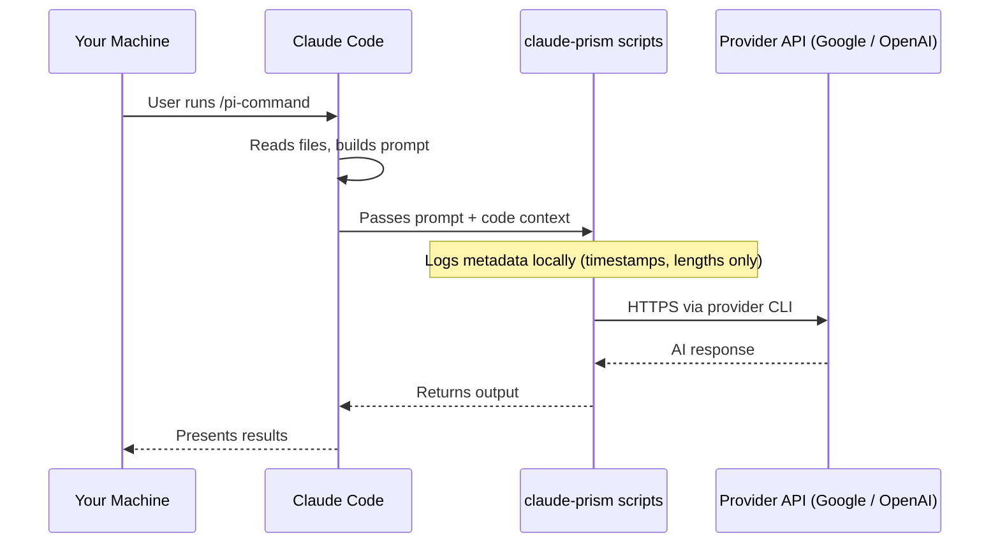

# Privacy & Data Flow

claude-prism is a local Bash wrapper, not a hosted proxy or relay service. There is no intermediary server between your machine and the AI providers.

[繁體中文](privacy.zh-TW.md) · [← Back to README](../README.md)

---

## Data Flow

## What Gets Sent to External Providers

- Code snippets, diffs, or file contents relevant to your command
- The prompt assembled by Claude Code (review instructions, context)
- Model selection metadata (model name, flags)

## What Stays Local

- **Logs**: `~/.claude/logs/multi-ai.log` records metadata only (timestamps, prompt/response byte lengths) — no code content
- **Review history**: `~/.claude/logs/review-insights.jsonl` — one structured JSON line per review. Each record is Claude's interpretation of the providers' output (category, severity, confidence, source, and an issue title derived from the AI response), not a raw transcript
- **Provider CLI output** (v0.14.2+): `~/.claude/logs/pi-{codex,gemini}-last-XXXXXX` holds the raw provider response per invocation, one file per call. `pi-{codex,gemini}-last.out` is a symlink that always points to the latest. These files contain the **full response body**, not metadata — if your prompt carried sensitive code you'd rather not retain, delete them manually after the review. **Cross-session caveat**: the symlink is one shared stable pointer per provider; if you run two Claude Code sessions on the same machine and both invoke the same provider concurrently, a fallback `cat` on the symlink may land on the other session's response. Not a data leak to third parties, but it is cross-session within your own machine — worth knowing when handling unrelated confidential contexts in parallel
- **Plans and research**: `.claude/pi-plans/` and `.claude/pi-research/` files stay on your machine
- **No telemetry**: claude-prism has no analytics, no phone-home, no intermediary server

## What We Don't Control

Each provider's data handling is governed by the terms of the plan you sign in with, not by claude-prism:

- **Data retention** — whether and how long providers store your prompts/responses
- **Model training and human review** — whether your data is used to improve their models or read by people. This depends on the plan, not only the provider: API and business terms typically exclude training, while consumer plans may use your data unless you opt out. If you sign in to `agy` with a personal Google account, or to Codex CLI with a personal ChatGPT account, those commands run on a consumer plan; see below
- **Sub-processors** — the cloud infrastructure providers use (AWS, Google Cloud, Azure)

**Gemini commands (`agy` signed in with a personal Google account)**: these run under the [Google Antigravity Additional Terms](https://antigravity.google/terms), together with the [Google Terms of Service](https://policies.google.com/terms) and [Privacy Policy](https://policies.google.com/privacy), not the Gemini API terms (checked 2026-10-26).

- **What is collected** — section 3 calls it "Interactions": *"your user data, interaction data pertaining to your usage of the Service, related metadata connected to the Service, and any feedback you provide"*. This covers the prompts claude-prism sends, including any code or diffs in them
- **How it is used** — section 5: *"We use Interactions to evaluate, develop, and improve Google and Alphabet research, products, services and machine learning technologies. [...] Google employees and contractors may access, view, review and use Interactions. If you don't want your Interactions used in this way, navigate to settings to change your preference on how such data is used."*
- **Deletion** — section 3: email antigravity-support@google.com to request that your Interactions be deleted; until you do, they are used under the terms above
- **Terms risk** — Google does not support this kind of use on consumer plans; see [Gemini on Google consumer plans](../README.md#gemini-on-google-consumer-plans)

**Codex commands (Codex CLI signed in with a personal ChatGPT account)**: these run under the [OpenAI Terms of Use](https://openai.com/policies/row-terms-of-use/), and whether your data is used to train OpenAI's models depends on the setting described in [Data controls in ChatGPT](https://help.openai.com/en/articles/7730893-data-controls-in-chatgpt) (checked 2026-10-26).

- **On by default** — *"On personal workspaces with ChatGPT Free, Plus, or Pro, data sharing is enabled by default."* and *"If you use Codex on a personal ChatGPT plan, Improve the model for everyone also applies to your Codex tasks."* This covers the prompts claude-prism sends to Codex, including any code or diffs in them
- **How to turn it off** — either option is enough: in ChatGPT, open your account menu → **Settings** → **Data controls** and turn off **Improve the model for everyone**; or select **Do not train on my content** in the [OpenAI Privacy Portal](https://privacy.openai.com/). *"After you opt out, new conversations and tasks won't be used to train OpenAI models."* It applies to what you send after opting out
- **Separate Codex setting** — *"Codex has a separate Include environments setting in Codex settings that controls whether additional context from your Codex environments can be used to train OpenAI models. Changing your ChatGPT setting or opting out through the Privacy Portal does not change that setting."*
- **Business plans** — *"By default, OpenAI does not use content from ChatGPT Business, Enterprise, Edu, or ChatGPT for Healthcare workspaces to train its models."*

Provider terms:
- [Anthropic Consumer Terms of Service](https://www.anthropic.com/legal/consumer-terms) — Claude Code signed in with a Free, Pro, or Max plan
- [Anthropic Commercial Terms of Service](https://www.anthropic.com/legal/commercial-terms) — Claude Code signed in with an API key or a Team / Enterprise plan, and `ci-review.sh`
- [OpenAI Terms of Use](https://openai.com/policies/row-terms-of-use/) — Codex CLI signed in with a personal ChatGPT account
- [OpenAI Services Agreement](https://openai.com/policies/services-agreement/) — Codex CLI signed in with an API key or a ChatGPT Business / Enterprise account, and `ci-review.sh`
- [Google Antigravity Additional Terms](https://antigravity.google/terms) — Gemini commands (`agy`)
- [Gemini API Additional Terms](https://ai.google.dev/gemini-api/terms) — `ci-review.sh` only, which calls the Gemini API with `GEMINI_API_KEY`

> **For regulated or confidential projects**: If your codebase is subject to HIPAA, SOC 2, NDA, or similar compliance requirements, verify the full chain — Claude Code terms, the terms of each provider plan you sign in with, data retention settings, and your organization's internal approval process — before sending code to external providers.
