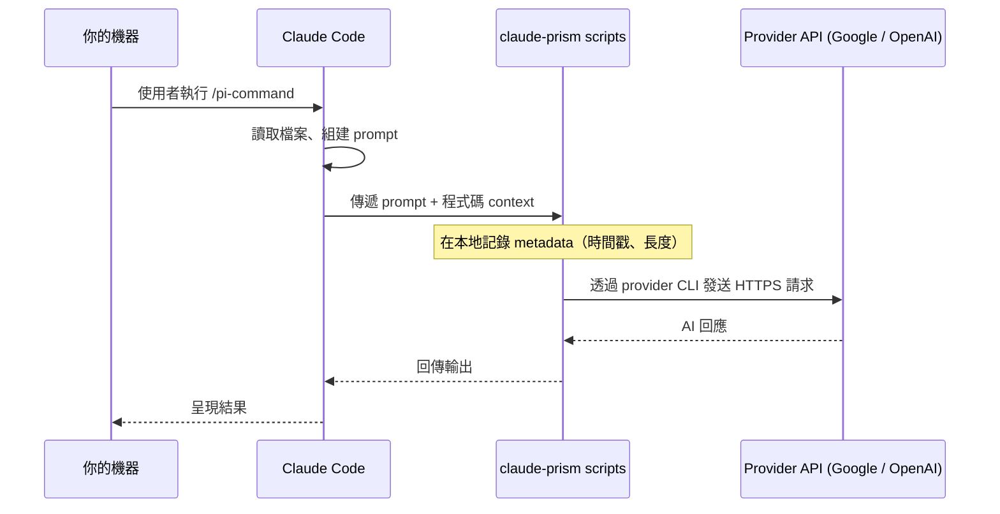

# 隱私與資料流向

claude-prism 是本地端 Bash wrapper，不是託管式代理或中繼服務。你的機器和 AI provider 之間沒有任何中介伺服器。

[English](privacy.md) · [← 返回 README](../README.zh-TW.md)

---

## 資料流向

## 送出到外部 Provider 的內容

- 與指令相關的程式碼片段、diff 或檔案內容
- Claude Code 組建的 prompt（審查指令、context）
- 模型選擇 metadata（模型名稱、flags）

## 留在本地的內容

- **Log 檔**：`~/.claude/logs/multi-ai.log` 僅記錄 metadata（時間戳、prompt/response 位元組長度）——不含程式碼內容
- **Review 歷史**：`~/.claude/logs/review-insights.jsonl`——每次 review 一行結構化 JSON。每筆紀錄是 Claude 對 provider 輸出的解讀（類別、嚴重度、信心度、發現來源，以及衍生自 AI 回應的問題標題），不是原始 transcript
- **Provider CLI 輸出**（v0.14.2+）：`~/.claude/logs/pi-{codex,gemini}-last-XXXXXX` 是每次呼叫的 provider 原始回應，一次呼叫一個檔案。`pi-{codex,gemini}-last.out` 是 symlink，永遠指向最新那次。這些檔案**存的是完整回應內容**，不是 metadata——如果你送出的 prompt 含敏感程式碼、不想留在硬碟上，review 結束後請自行刪除。**跨 session 提醒**：symlink 是單一共享指標（每個 provider 一個），若你同一台機器開兩個 Claude Code session 同時打同一個 provider，某次 fallback `cat` symlink 可能讀到另一個 session 的回應。這不會流到第三方，但在你自己機器上的 session 之間可能交叉——處理兩個無關但都機密的 context 時要留意
- **計畫與研究**：`.claude/pi-plans/` 和 `.claude/pi-research/` 檔案留在你的機器上
- **零遙測**：claude-prism 沒有分析服務、不會回傳資料、沒有中介伺服器

## 我們無法控制的部分

每個 provider 的資料處理方式，由你登入時所用方案的條款規範，不受 claude-prism 控制：

- **資料保留** — provider 是否及保留你的 prompt/回應多久
- **模型訓練與人工審閱** — 你的資料是否被用於改善模型，或被人看到。這取決於方案，不只取決於 provider：API 與商業條款通常排除訓練，個人方案則可能在你沒有關閉時使用你的資料。用個人 Google 帳號登入 `agy`，或用個人 ChatGPT 帳號登入 Codex CLI 時，這些指令跑的就是個人方案，見下方說明
- **子處理者** — provider 使用的雲端基礎設施（AWS、Google Cloud、Azure）

**Gemini 指令（`agy` 以個人 Google 帳號登入）**：適用 [Google Antigravity 附加服務條款](https://antigravity.google/terms)，以及 [Google 服務條款](https://policies.google.com/terms)與[隱私權政策](https://policies.google.com/privacy)，不是 Gemini API 條款（2026-10-26 查證）。

- **收集什麼** — 第 3 條稱為「Interactions」：*"your user data, interaction data pertaining to your usage of the Service, related metadata connected to the Service, and any feedback you provide"*。claude-prism 送出的 prompt，連同其中的程式碼與 diff，都在這個範圍內
- **怎麼使用** — 第 5 條：*"We use Interactions to evaluate, develop, and improve Google and Alphabet research, products, services and machine learning technologies. [...] Google employees and contractors may access, view, review and use Interactions. If you don't want your Interactions used in this way, navigate to settings to change your preference on how such data is used."*
- **刪除** — 第 3 條：寄信到 antigravity-support@google.com 要求刪除你的 Interactions；在你提出之前，它們會照上述條款使用
- **條款風險** — Google 不支援在個人方案上這樣使用，見[在 Google 個人方案上使用 Gemini](../README.zh-TW.md#在-google-個人方案上使用-gemini)

**Codex 指令（Codex CLI 以個人 ChatGPT 帳號登入）**：適用 [OpenAI 使用條款](https://openai.com/policies/row-terms-of-use/)；你的資料會不會被拿去訓練 OpenAI 的模型，取決於 [ChatGPT 中的資料控管](https://help.openai.com/zh-hant/articles/7730893-data-controls-in-chatgpt) 說明的設定（2026-10-26 查證）。

- **預設開啟** — *"On personal workspaces with ChatGPT Free, Plus, or Pro, data sharing is enabled by default."*、*"If you use Codex on a personal ChatGPT plan, Improve the model for everyone also applies to your Codex tasks."* claude-prism 送給 Codex 的 prompt，連同其中的程式碼與 diff，都在這個範圍內
- **怎麼關** — 兩個方法擇一即可：在 ChatGPT 開啟帳戶選單 →「設定」→「資料控管」，關閉「為所有人改善模型」（Improve the model for everyone）；或在 [OpenAI 隱私權入口網站](https://privacy.openai.com/)選取「不要使用我的內容進行訓練」（Do not train on my content）。*"After you opt out, new conversations and tasks won't be used to train OpenAI models."* 只對選擇退出之後送出的內容有效
- **Codex 另有一個設定** — *"Codex has a separate Include environments setting in Codex settings that controls whether additional context from your Codex environments can be used to train OpenAI models. Changing your ChatGPT setting or opting out through the Privacy Portal does not change that setting."* 中文介面稱為「包含環境」
- **商業方案** — *"By default, OpenAI does not use content from ChatGPT Business, Enterprise, Edu, or ChatGPT for Healthcare workspaces to train its models."*

Provider 條款：
- [Anthropic 消費者服務條款](https://www.anthropic.com/legal/consumer-terms) — Claude Code 以 Free、Pro 或 Max 方案登入時
- [Anthropic 商業服務條款](https://www.anthropic.com/legal/commercial-terms) — Claude Code 以 API key 或 Team／Enterprise 方案登入時，以及 `ci-review.sh`
- [OpenAI 使用條款](https://openai.com/policies/row-terms-of-use/) — Codex CLI 以個人 ChatGPT 帳號登入時
- [OpenAI 服務合約](https://openai.com/policies/services-agreement/) — Codex CLI 以 API key 或 ChatGPT Business／Enterprise 帳號登入時，以及 `ci-review.sh`
- [Google Antigravity 附加服務條款](https://antigravity.google/terms) — Gemini 指令（`agy`）
- [Gemini API 附加服務條款](https://ai.google.dev/gemini-api/terms) — 僅 `ci-review.sh`，它用 `GEMINI_API_KEY` 呼叫 Gemini API

> **合規或機密專案注意**：若你的程式碼受 HIPAA、SOC 2、NDA 或類似合規要求約束，請在將程式碼送至外部 provider 前，確認完整鏈結——Claude Code 條款、你登入時所用各 provider 方案的條款、資料保留設定，以及你所屬組織的內部核准流程。
